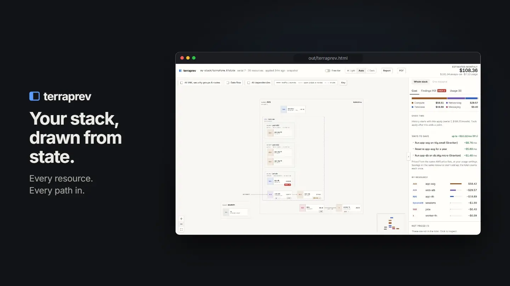

# terraprev

**See your Terraform stack's architecture and AWS cost, every time you apply.**

Point terraprev at a `terraform.tfstate` and you get:

1. **An architecture diagram** of your VPCs, subnets and resources, with the traffic between them.
2. **A monthly AWS cost estimate**, line by line, from AWS's official price list.
3. **A brief for your CTO**: summary, cost drivers, risks and how to fix them, as Markdown or PDF.

It runs on your machine: no AWS account, no credentials, nothing uploaded. It also works with emulators such as LocalStack or floci, showing what the same stack would cost on real AWS.



▶ [Watch the full walkthrough (40 s, 1080p)](https://github.com/user-attachments/assets/7b04d45c-6bab-4694-8a38-c2935a35b517)

## Features

### See the architecture

- **Diagram, laid out for you.** Cloud → VPC → subnets → resources. Arrows come from real relationships in state: ALB → ASG, SNS → SQS, SQS → Lambda, security-group rules (`ASG → RDS tcp 5432`).
- **Data flow.** Pick a resource and every path that can reach it lights up, e.g. *Internet → ALB → ASG → RDS*.
- **Access in plain English.** Draw a resource's IAM role, policies and security groups on the diagram.
- **Inspector.** Click anything for its configuration and the `resource {}` block from your `.tf` files.

### Know the cost

- **Monthly estimate** from the AWS Price List API, on-demand prices for your region.
- **Every dollar explained.** Each line shows quantity × unit price, linked to the SKU and the price file behind it.
- **Usage sliders** for traffic-based charges (Lambda invocations, S3 storage, NAT data…); the total follows. Optional AWS Always Free tier.
- **Nothing hidden.** Anything terraprev can't price is listed as *not priced*, never counted as $0.

### Share it

- **CTO brief.** Executive summary, cost drivers, findings and security posture, as Markdown (with a Mermaid diagram) or PDF.
- **Findings with fixes.** Rule-based checks for disabled backups, unencrypted storage, IMDSv1, open ports and more.
- **One snapshot file.** A self-contained HTML page that opens offline, plus an optional one-page diagram PDF. The same inputs always give byte-identical files.
- **Always current.** `bin/tf` rebuilds the snapshot on every apply; live mode updates the page within a second.
- **Ask your AI assistant.** An MCP server lets Claude, Cursor and other assistants read the same diagram, costs and findings. See [MCP](#mcp).

## Quick start

Needs **Node.js 22.18+**. Command-line PDF export also needs Chrome, Edge, Brave or Chromium.

```bash
git clone https://github.com/hohkokyoung/terraprev && cd terraprev
npm install
npm run snapshot -- --state ../my-stack/terraform.tfstate --open
```

The first run downloads AWS price lists (about a minute) and caches them. After that, builds take ~30 ms and need no network.

**Rebuild on every apply.** `bin/tf` is a drop-in wrapper for `terraform`: it runs the real command, then rebuilds the snapshot whenever state may have changed. A failed snapshot never fails your apply.

```bash
~/terraprev/bin/tf apply
TERRAPREV_BUILD_ARGS="--pdf --report" tf apply   # also write the PDFs
```

**Live mode.** `npm run dev` serves http://localhost:4600 and updates within a second of each apply, highlighting what changed.

## MCP

terraprev also runs as an [MCP](https://modelcontextprotocol.io) server, so an AI assistant can answer questions like *"what does this stack cost, and what's driving it?"* or *"what can reach the database?"* from your state file. It uses the same code as the snapshot, and runs locally over stdio.

Claude Code:

```bash
claude mcp add terraprev -- node ~/terraprev/server/src/cli/mcp.ts --state ~/my-stack/terraform.tfstate
```

Other clients (Claude Desktop, Cursor…) take the same command in their JSON config:

```json
{
  "mcpServers": {
    "terraprev": {
      "command": "node",
      "args": ["/path/to/terraprev/server/src/cli/mcp.ts", "--state", "/path/to/terraform.tfstate"]
    }
  }
}
```

`--state` is optional (default: `stateFile` in config), and every tool also takes a `state` path, so one server can answer for several stacks. `--offline` never downloads prices. Run `npm run snapshot` once first so the price cache is ready; otherwise the first call waits about a minute for the download.

| Tool | Returns |
|---|---|
| `stack_overview` | Summary, monthly total, top cost lines, finding counts, every resource |
| `estimate_cost` | Every cost line (quantity × unit price, SKU, price page), usage assumptions, unpriced resources. Takes `usage` overrides and `free_tier` |
| `list_findings` | Findings with what was seen and how to fix it, optionally by severity |
| `describe_resource` | One resource: configuration, location, connections, paths that reach it, IAM and security groups, cost, findings, its `.tf` block |
| `get_brief` | The CTO brief as Markdown |
| `build_snapshot` | Writes the HTML snapshot, and optionally the PDFs and brief |

The tools return what the page shows: sensitive values never appear in them.

## Options

`npm run snapshot -- [options]`

| Option | Description |
|---|---|
| `--state <path>` | State file to read (default: `stateFile` in config) |
| `--out <file.html>` | Snapshot path; other outputs go next to it (default `out/terraprev.html`) |
| `--open` | Open the snapshot when done |
| `--pdf`, `--pdf-out <file>` | Also write the diagram as an A4 landscape PDF |
| `--report` | Also write the CTO brief as `<stack>-brief.md` and `.pdf` |
| `--theme light\|dark` | Theme for the PDFs |
| `--free-tier` | Apply AWS Always Free allowances in the PDFs and brief |
| `--offline` / `--refresh-prices` | Never download prices / re-download them now |
| `-q`, `--quiet` | Print only errors |

For remote state (S3, Terraform Cloud…), pull it to a file first: `terraform state pull > /tmp/stack.tfstate`.

Defaults live in `terraprev.config.json`: `stateFile`, `defaultRegion`, `port` and `priceCacheDays` (how often prices refresh, default 7). The environment variables `TERRAPREV_STATE`, `TERRAPREV_REGION`, `PORT` and `CHROME_PATH` override them.

## How it works

**Costs.** Always-on charges (instance hours, NAT, ALB, public IPv4, RDS storage…) come from state × 730 hours. Usage charges come from the sliders. Free resources (IAM, subnets, security groups…) are listed at $0. Prices are USD on-demand. Savings plans, reserved capacity, taxes and data transfer out are not included.

**Findings.** Plain rules over state attributes, with no AI and no guessing. For example: RDS backups disabled (`backup_retention_period = 0`), storage not encrypted, IMDSv1 allowed, one NAT gateway for several AZs, non-web ports open to `0.0.0.0/0`, credentials hard-coded in user data.

**Offline use.** Only the price lists need the internet: once on the first run, then a refresh every 7 days (`priceCacheDays`). If a refresh fails, the cached prices are used; `--offline` never tries. Everything else works without a connection, apart from the links to AWS pricing pages and raw price files.

**Privacy.** The only network requests are downloads of AWS's public price lists. Values Terraform marks as sensitive never reach the page or the reports. The live server listens on `127.0.0.1` only. Snapshots include your resource names and `.tf` blocks, so share them as carefully as the state file.

## Limitations

- Prices AWS only. Other providers are drawn but not priced.
- Shows what was last applied, not pending changes in your `.tf` files.
- Assumes Linux on-demand prices for EC2.
- Findings cover only what the rules check: no finding doesn't mean no problem.

## Development

```bash
npm run dev         # live server + web app with hot reload
npm test            # offline test suite
npm run typecheck
```

| To add… | Edit |
|---|---|
| A resource type to the diagram | `server/src/graph/catalog.ts` |
| A pricing rule | `server/src/pricing/aws/mappers.ts` (+ a test in `server/test/pricing.test.ts`) |
| A finding | `server/src/insights/aws.ts` |
| An AWS display name | `shared/awsNames.ts` |
| Another cloud | implement `ProviderPricer` in `server/src/pricing/types.ts` |

The demo video is made with [Remotion](https://www.remotion.dev) from screenshots of a real snapshot: `npm run capture` (needs `out/terraprev.html`), then, in `video/`, `npm run teaser` (the looping `docs/teaser.webp` at the top of this page) and `npm run render` (the full video, `video/out/demo.mp4`). GitHub only plays video it hosts, so to update the walkthrough link drag that MP4 into a GitHub issue or comment box and use the link it gives.
